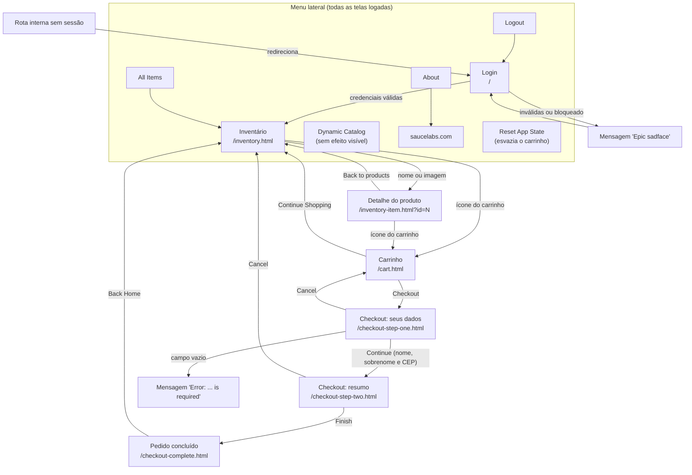

# Requisitos inferidos do SauceDemo (engenharia reversa)

Requisitos e regras de negócio deduzidos a partir do **comportamento observado** do
[SauceDemo](https://www.saucedemo.com), sem acesso a especificação. Cada regra foi observada em
pelo menos duas execuções independentes (Chromium, Playwright 1.63, 15/10/2026). O
[código-fonte oficial](https://github.com/saucelabs/sample-app-web) foi usado apenas para
confirmar regras já observadas, como o imposto de 8%.

Bugs e divergências estão detalhados no [relatório de bugs](relatorio-de-bugs.md).

## Sumário

- [Mapa de telas e fluxos](#mapa-de-telas-e-fluxos)
- [Regras de negócio](#regras-de-negócio)
- [Como o estado funciona](#como-o-estado-funciona)
- [Matriz usuário × funcionalidade](#matriz-usuário--funcionalidade)
- [Tempos do performance_glitch_user](#tempos-do-performance_glitch_user)

---

## Mapa de telas e fluxos

| Tela | Rota | Elementos principais (`data-test`) |
|---|---|---|
| Login | `/` | `username`, `password`, `login-button`, `error` |
| Inventário | `/inventory.html` | `inventory-item`, `inventory-item-name`, `inventory-item-price`, `product-sort-container`, `add-to-cart-*` / `remove-*` |
| Detalhe | `/inventory-item.html?id=N` | `inventory-item-name`, `inventory-item-price`, `add-to-cart` / `remove`, `back-to-products` |
| Carrinho | `/cart.html` | `inventory-item`, `item-quantity`, `continue-shopping`, `checkout` |
| Checkout 1 | `/checkout-step-one.html` | `firstName`, `lastName`, `postalCode`, `continue`, `cancel`, `error` |
| Checkout 2 | `/checkout-step-two.html` | `subtotal-label`, `tax-label`, `total-label`, `payment-info-value`, `shipping-info-value`, `finish` |
| Concluído | `/checkout-complete.html` | `complete-header`, `back-to-products` |
| Menu | (todas as telas logadas) | `inventory-sidebar-link`, `dynamic-catalog-sidebar-link`, `about-sidebar-link`, `logout-sidebar-link`, `reset-sidebar-link` |

---

## Regras de negócio

### Autenticação

| ID | Regra observada |
|---|---|
| RN-01 | A senha de todos os usuários aceitos é `secret_sauce`. |
| RN-02 | Usuário e senha são obrigatórios, nesta ordem de validação: primeiro "Username is required", depois "Password is required". |
| RN-03 | `locked_out_user` é recusado com "Sorry, this user has been locked out." |
| RN-04 | Rotas internas sem sessão redirecionam para o login com "You can only access '<rota>' when you are logged in." |
| RN-05 | A sessão vale **10 minutos**: o cookie `session-username` expira 600 s após o login. |
| RN-06 | O cookie só é aceito com um usuário válido e não bloqueado, com diferença entre maiúsculas e minúsculas. `usuario_falso`, `STANDARD_USER` e `locked_out_user` no cookie levam de volta ao login. |

### Catálogo

| ID | Regra observada |
|---|---|
| RN-07 | O catálogo tem 6 produtos, abre ordenado por nome A–Z e oferece 4 ordenações: `az`, `za`, `lohi` e `hilo`. |
| RN-08 | Cada produto tem um id fixo usado na URL e no carrinho: Bike Light=0, Bolt T-Shirt=1, Onesie=2, T-Shirt (Red)=3, Backpack=4, Fleece Jacket=5. |
| RN-09 | Clicar no nome ou na imagem do produto abre o detalhe do mesmo produto. |
| RN-10 | Um id inexistente na URL (`6`, `-1`, `999`) abre a página "ITEM NOT FOUND", com preço `$√-1` e imagem de erro. |

### Carrinho

| ID | Regra observada |
|---|---|
| RN-11 | Cada produto entra no carrinho no máximo uma vez: o botão alterna entre "Add to cart" e "Remove", e a quantidade é sempre 1. |
| RN-12 | O contador do carrinho mostra a quantidade de itens e some quando o carrinho está vazio. |
| RN-13 | O carrinho fica no `localStorage` (`cart-contents`, lista JSON de ids) e sobrevive a recarregar a página. |
| RN-14 | "Reset App State" esvazia o carrinho (`localStorage` e contador). |

### Checkout

| ID | Regra observada |
|---|---|
| RN-15 | Nome, sobrenome e CEP são obrigatórios, validados nessa ordem e um de cada vez. |
| RN-16 | O CEP aceita qualquer texto (não há validação de formato). |
| RN-17 | Imposto = 8% do subtotal, arredondado a 2 casas; total = subtotal + imposto. Confirmado no código-fonte oficial (`utils/orderCalculations.js`). |
| RN-18 | Pagamento ("SauceCard #31337") e entrega ("Free Pony Express Delivery!") são fixos. |
| RN-19 | Concluir o pedido esvazia o carrinho. |
| RN-20 | Recarregar o resumo (passo 2) mantém os dados; voltar do passo 2 para o passo 1 apaga o formulário. |

---

## Como o estado funciona

| Mecanismo | Chave | Conteúdo | Efeito de manipulação |
|---|---|---|---|
| Cookie | `session-username` | Nome do usuário em texto puro, validade de 10 min | Usuário inexistente, bloqueado ou com maiúsculas: volta ao login (RN-06). Trocar o valor por outro usuário válido muda o perfil sem senha. |
| `localStorage` | `cart-contents` | Lista JSON de ids, ex.: `[4,0]` | Id inexistente (`[999]`, `[-1]`, `[6]`): o contador mostra 1, mas o carrinho fica vazio (BUG-004). Id repetido (`[4,4]`): o item aparece e é cobrado duas vezes (S-04). Texto que não é JSON: erro JavaScript não tratado, carrinho vazio (S-04). |
| URL | `?id=N` | Id do produto no detalhe | Id inexistente: página "ITEM NOT FOUND" com "Add to cart" habilitado (BUG-004). |
| HTTP | — | Aplicação de página única (SPA) | Rotas internas respondem **HTTP 404** e a página é montada pelo JavaScript (BUG-005). |
| Telemetria | Backtrace | Envio de eventos com `UNIVERSE`/`TOKEN` literais | Enviados na primeira carga de cada sessão do navegador; recebem 401 e geram erros no console (BUG-006). Desde 27/10/2026 o Backtrace demora mais que o limite de 15 s do cliente, que aborta as chamadas sem status e tenta de novo após 10 s. Os erros reportados pelo site (ex.: ordenação do `error_user`) causam erros de CORS. |

---

## Matriz usuário × funcionalidade

Referência: `standard_user`. ✅ = igual ao `standard_user`; ❌ = diverge (bug); ⏱ = mais lento; — = não se aplica.

| Funcionalidade | standard | locked_out | problem | performance_glitch | error | visual |
|---|:-:|:-:|:-:|:-:|:-:|:-:|
| Login | ✅ | ❌ bloqueado (intencional) | ✅ | ⏱ ~5,1 s | ✅ | ✅ |
| Imagens do inventário | ✅ | — | ❌ todas `sl-404` (BUG-007) | ✅ | ✅ | ❌ Backpack com `sl-404` (BUG-020) |
| Preços do inventário | ✅ | — | ✅ | ✅ | ✅ | ❌ aleatórios a cada carregamento (BUG-019) |
| Layout do inventário | ✅ | — | ✅ | ✅ | ✅ | ❌ carrinho deslocado (BUG-021) e botão desalinhado (BUG-022) |
| Ordenação | ✅ | — | ❌ não ordena (BUG-008) | ⏱ ~5,0 s | ❌ alerta "Sorting is broken!" (BUG-014) | ✅ (sobre preços aleatórios) |
| Adicionar ao carrinho | ✅ | — | ❌ falha em 3 produtos (BUG-010) | ✅ | ❌ falha em 3 produtos (BUG-015) | ✅ |
| Remover do carrinho | ✅ | — | ❌ falha nos outros 3 (BUG-010) | ✅ | ❌ falha nos outros 3 (BUG-015) | ✅ |
| Detalhe do produto | ✅ | — | ❌ abre o produto seguinte (BUG-011) | ✅ | ✅ | ✅ |
| Checkout: campo nome | ✅ | — | ✅ | ✅ | ✅ | ✅ |
| Checkout: campo sobrenome | ✅ | — | ❌ texto vai para o nome (BUG-009) | ✅ | ❌ não aceita texto (BUG-016) e não é validado (BUG-017) | ✅ |
| Checkout: Finish | ✅ | — | ✅ | ✅ | ❌ não conclui (BUG-018) | ✅ |
| Carrinho vazio após o pedido | ✅ | — | ❌ continua com o item (BUG-013) | ✅ | — | ✅ |
| Menu: About | ✅ | — | ❌ aponta para `/error/404` (BUG-012) | ✅ | ✅ | ✅ |
| Voltar ao inventário | ✅ | — | ✅ | ⏱ ~5,1 s | ✅ | ✅ |

Bugs que afetam **todos** os usuários, inclusive o `standard_user`: BUG-001 a BUG-006 e BUG-023 (menu lateral que abre invisível se clicado logo após a página carregar, numa máquina lenta).

### Padrão nos botões do problem_user e do error_user

Os dois perfis falham exatamente nos mesmos produtos, tanto no inventário quanto no detalhe:

| Produto (id) | Adicionar | Remover depois de adicionar |
|---|:-:|:-:|
| Bike Light (0) | ✅ | ❌ |
| Bolt T-Shirt (1) | ❌ | — |
| Onesie (2) | ✅ | ❌ |
| T-Shirt (Red) (3) | ❌ | — |
| Backpack (4) | ✅ | ❌ |
| Fleece Jacket (5) | ❌ | — |

No `error_user`, cada falha também gera um erro JavaScript ("Failed to add item to the cart." ou
"Failed to remove item from cart."). No `problem_user`, a falha é silenciosa.

---

## Tempos do performance_glitch_user

Três medições por ação, em milissegundos, do clique até o resultado aparecer na tela:

| Ação | standard_user | performance_glitch_user | Diferença |
|---|---|---|---|
| Login até o inventário | 91 / 77 / 96 | 5106 / 5109 / 5112 | +~5,0 s |
| Ordenar por preço (maior → menor) | 23 / 24 / 22 | 5022 / 5024 / 5021 | +~5,0 s |
| Adicionar ao carrinho | 33 / 33 / 44 | 37 / 35 / 37 | igual |
| Finish no checkout | 88 / 90 / 78 | 95 / 81 / 93 | igual |
| Back Home (volta ao inventário) | 65 / 61 / 61 | 5108 / 5107 / 5109 | +~5,0 s |

O atraso é fixo, de cerca de 5 s, e acontece **sempre que o inventário é renderizado** (login,
ordenação e retorno ao inventário). Ações que não renderizam a lista não são afetadas. É
comportamento intencional do perfil, por isso não aparece como bug: os testes usam um tempo
limite maior apenas onde o inventário é renderizado.
